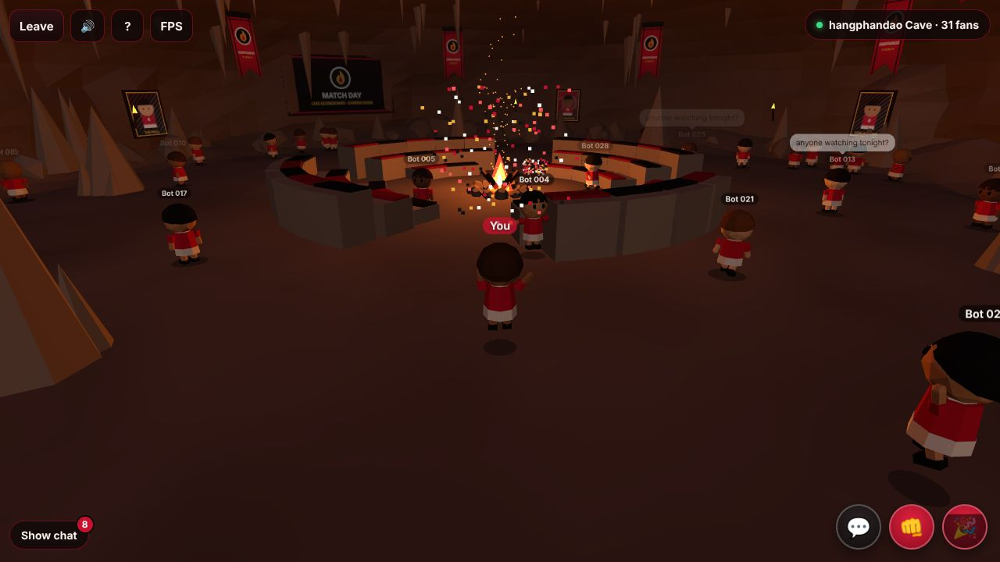

# hangphandao Cave

A browser-based 3D multiplayer hangout for the **hangphandao** fan club. Walk around a
firelit cave as a little chibi fan, chat, punch your mates (cosmetically) and celebrate
together. Works on desktop and phones.



- **Client:** Three.js + TypeScript + Vite. Everything is procedural (no models or image assets).
- **Server:** Node.js + Colyseus 0.15, authoritative room state at 20 Hz.
- **Shared:** one TS package with the message/state types, constants, world layout and the
  deterministic movement code used by both sides.
- **Deploy:** Docker Compose on a single VPS: game server container plus a Caddy container that
  serves the client, proxies WebSockets and handles HTTPS automatically.

## Quick start (development)

Requires Node 22+ and pnpm 10 (`corepack enable`).

```bash
pnpm install
pnpm dev          # server on :2567 (tsx watch) + client on :5173 (Vite)
```

Open http://localhost:5173. Vite proxies `/colyseus/*` to the game server, so dev uses the
same URL layout as production. Open a second tab to see yourself from the outside.

Useful URL flags:

| Flag             | Effect                                                              |
| ---------------- | ------------------------------------------------------------------- |
| `?dev`           | Show the FPS / draw calls / ping overlay on load (or press `` ` ``) |
| `?offline`       | Single-player, no server needed                                     |
| `?touch`         | Force the mobile joystick UI on desktop                             |
| `?server=ws://…` | Connect to a different game server endpoint                         |

### Scripts

| Command                     | What it does                                                |
| --------------------------- | ----------------------------------------------------------- |
| `pnpm dev`                  | Run client + server with hot reload                         |
| `pnpm build`                | Production build (`client/dist`, `server/dist/index.cjs`)   |
| `pnpm test`                 | Vitest: server validation, room integration, client netcode |
| `pnpm typecheck`            | Strict `tsc` on every package                               |
| `pnpm lint` / `pnpm format` | ESLint / Prettier                                           |
| `pnpm check`                | All of the above (what CI runs)                             |
| `pnpm loadtest`             | 50 headless bots wandering, chatting and emoting            |

Load test options: `pnpm loadtest -- --bots 80 --duration 120 --url wss://cave.example.com/colyseus`.
It exits non-zero if any bot fails to join or is dropped.

## Controls

| Desktop           | Mobile             | Action              |
| ----------------- | ------------------ | ------------------- |
| WASD / arrow keys | Left thumbstick    | Walk                |
| Drag mouse, wheel | Drag screen, pinch | Orbit / zoom camera |
| Enter             | 💬                 | Chat (Esc closes)   |
| F                 | 👊                 | Punch               |
| E / Space         | 🎉                 | Celebrate           |

## Project layout

```
shared/src/      constants.ts   CLUB_NAME, tick rate, limits (one place to tune)
                 world.ts       walkable area, seats, pillars, spawn points
                 movement.ts    deterministic step + capsule collision + MoveBudget
                 sanitize.ts    nickname / chat sanitising
                 emotes.ts      punch hit test, cooldown + rate limiter
                 messages.ts    message names + payload types
                 state.ts       synced state shape
server/src/      index.ts       HTTP (/health) + Colyseus server
                 rooms/         CaveRoom, schema state, per-player session
                 features/      movement, chat, emotes (pure, unit-tested)
                 moderation/    profanity filter hook
server/test/     unit + integration tests
server/loadtest/ bot load test
client/src/      game/          Game loop, input, third-person camera
                 world/         cave, campfire, confetti, procedural textures
                 actors/        Avatar animation + instanced CharacterRenderer
                 net/           NetSession, client prediction, interpolation
                 ui/            landing, HUD, chat, joystick, labels, modals
deploy/Caddyfile
Dockerfile, docker-compose.yml
```

## How it works

### Networking

- **One room type, auto-sharded.** Clients `joinOrCreate('cave')`. A room holds up to
  100 fans. When it's full, Colyseus opens another instance automatically. The HUD count
  ("hangphandao Cave · N fans") is per instance.
- **Server-authoritative movement.** Clients never send positions. They send input frames
  `[seq, dx, dz, dt]` in batches at 20 Hz. The server re-simulates every frame with the
  same `stepMovement` code, normalising direction to at most unit length and clamping `dt`.
  A wall-clock `MoveBudget` stops speed hacks that send inputs faster than real time.
  Movement is pushed out of seats, pillars and the fire, then clamped to the walkable disc.
  Malformed, replayed and out-of-order frames are dropped.
- **Client prediction + reconciliation.** The local player moves immediately. When state
  arrives, the client rewinds to the server position, replays the inputs the server hasn't
  acknowledged yet (`seq`), and blends out any visible error.
- **Interpolation.** Remote players are rendered 100 ms in the past, between buffered snapshots.
- **Reconnects.** If a socket drops, the server keeps the avatar (shown as "reconnecting…")
  for 5 s via `allowReconnection`. After that it's removed. Dead sockets are detected by a
  1.5 s ping. The client retries automatically and, after a server restart or deploy, rejoins
  as a fresh fan.

### Chat and emotes

- Chat is sanitised (control characters stripped, whitespace collapsed, 200 character cap),
  rate-limited to 1 msg/s per player, and run through a pluggable filter
  (`server/src/moderation/profanity.ts`; replace it with `setTextFilter()`). The last 50
  messages are replayed to new joiners. Messages show in the panel and as 4 s speech bubbles.
- **Punch** checks for players within 1.5 m in a 120° cone in front, using server positions.
  Anyone hit plays a cosmetic stagger. **Celebrate** plays a jump/wave with confetti.
  Both have a 2 s per-emote cooldown on the server (mirrored on the client for instant
  feedback) and are only sent to players within 25 m.

### Performance budget

Target: 60 FPS on mid-range phones, with fewer than 100 draw calls.

- The cave is about 20 draw calls. Repeated props (stalactites, rocks, seats, cushions,
  banners, frames, torches, flames) are `InstancedMesh`es. Posters share one atlas
  texture and one merged mesh.
- **Characters cost a constant ~12 draw calls no matter how many fans are online.** Each
  body part is one `InstancedMesh` and the pose matrices are computed on the CPU.
  A full cave of 50+ fans still renders in about 30 draw calls (check with `?dev`).
- Name tags and speech bubbles are DOM overlays projected from 3D. They cost no draw
  calls, always face the camera and fade with distance.
- Lighting is one flickering point light, a hemisphere light, and a cheap directional
  fill that follows the camera. There are no shadow maps; characters get blob shadows.
  On phones the pixel ratio is capped at 1.5.

## Deploying to a VPS

Needs Docker Engine with Compose v2. A small VPS (1 vCPU / 1 GB RAM) should be plenty for a few full caves.

1. **DNS:** point an `A` (and optionally `AAAA`) record for your domain, e.g.
   `cave.example.com`, at the VPS.
2. **Firewall:** open TCP 80 and 443, and UDP 443 (HTTP/3).
   ```bash
   sudo ufw allow 80/tcp && sudo ufw allow 443/tcp && sudo ufw allow 443/udp
   ```
3. **Install Docker:**
   ```bash
   curl -fsSL https://get.docker.com | sh
   ```
4. **Get the code and configure:**
   ```bash
   git clone https://github.com/onggiahuy97/fancave.git && cd fancave
   cp .env.example .env
   nano .env          # SITE_ADDRESS=cave.example.com
   ```
5. **Build and start:**
   ```bash
   docker compose up -d --build
   docker compose ps                  # server should be "healthy"
   curl https://cave.example.com/healthz
   ```
   Caddy requests the Let's Encrypt certificate on first start (it needs ports 80/443
   reachable) and renews it automatically. Certificates persist in the `caddy_data` volume.

**Updating:** `git pull && docker compose up -d --build`. Connected players see
"reconnecting…" for a moment and rejoin automatically.

**Logs:** `docker compose logs -f server` / `docker compose logs -f web`.

**Variants:**

- _Behind another proxy / load balancer that terminates TLS:_ set `SITE_ADDRESS=:80`
  and, if needed, `HTTP_PORT=8080`. Forward WebSocket upgrades for `/colyseus/*`.
- _Local smoke test of the production stack:_ `SITE_ADDRESS=:80 HTTP_PORT=8080 docker compose up --build`,
  then open http://localhost:8080.
- _Building behind a TLS-inspecting proxy:_ pass the proxy's CA as a build secret:
  `docker build --secret id=extra_ca,src=ca.pem --target server .` (and `--target web`).

### URL layout in production

| Path          | Served by                                         |
| ------------- | ------------------------------------------------- |
| `/`           | Static client (`client/dist`), SPA fallback       |
| `/assets/*`   | Hashed bundles, cached for 1 year (immutable)     |
| `/colyseus/*` | Game server (matchmaking HTTP + room WebSockets)  |
| `/healthz`    | Game server health: `{ ok, uptime, rooms, fans }` |

### Scaling beyond one process

A single Node process comfortably handles several full caves; each room does very little
work per tick. To run multiple processes or machines, add Colyseus' Redis presence and
driver (`@colyseus/redis-presence`, `@colyseus/redis-driver`) and route
`/colyseus/<processId>/*` to the right process.

## Customising

- **Club name:** `CLUB_NAME` in `shared/src/constants.ts`. It's used in the title, HUD,
  banners and landing screen.
- **Colours:** `client/src/world/textures.ts` (banners/posters) and the CSS variables at the
  top of `client/src/styles.css`.
- **Gameplay limits** (speed, cap, chat length, cooldowns, reconnect window) live in
  `shared/src/constants.ts` and apply to both client and server.

All art is original and procedural: no real club logos, crests, player photos or trademarks.

## Extension points (planned, not in v1)

- **Live scoreboard / watch-party screen:** the cave already has a framed wall screen
  (`Cave.screenMount`, currently "MATCH DAY · COMING SOON"). Replace its material with a
  `CanvasTexture` (scoreboard) or `VideoTexture` (watch party). Sync it with a new
  `@type` field on `CaveState`, or a new `S2C` message, from a feature module in
  `server/src/features/` registered in `CaveRoom.onCreate()`.
- **Accounts:** `CaveRoom.onAuth()` is the single place that turns join options into an
  identity. Swap nickname validation for token verification; the returned object becomes
  `client.auth`.
- **Voice chat:** add a signalling message pair alongside chat (WebRTC). The room already
  knows who is near whom (`nearbyRecipients`), which works for proximity voice.
- **New emotes:** add the name to `EMOTES` in `shared/src/messages.ts`, add an animation
  branch in `client/src/actors/Avatar.ts`, and add a button in `Hud.ts`.
